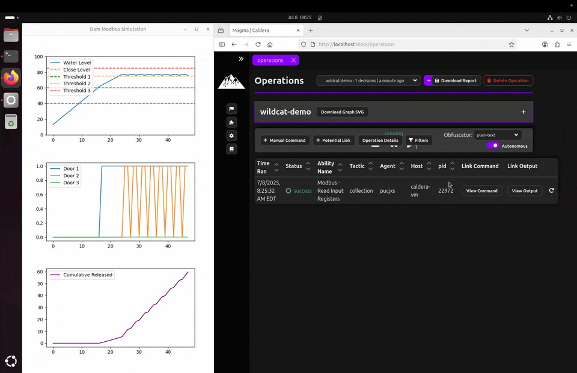

# Wildcat Dam

A simulated dam controller with Modbus process control, built as a target for [MITRE Caldera™ for OT](https://github.com/mitre/caldera-ot). For a walkthrough, read [Announcing Wildcat Dam: Your Virtual OT Protocol Sandbox!](https://medium.com/@mitrecaldera/caldera-for-ot-c4ot-announcing-wildcat-dam-your-virtual-ot-protocol-sandbox-074f68d1d0d1).



## Authors

Created by University of Arizona INSuRE students: Dalia Castro, Perla Gutierrez, Samuel Moreno, and Ben Trout.

In collaboration with MITRE Caldera™ for OT ([ot@mitre.org](mailto:ot@mitre.org)).

Wildcat Dam is intended to grow open source collaboration in OT. We encourage forks and pull requests with improvements, new features, deployment notes, documentation, and tests.

The students' original version is preserved in the [v1.0.0 release](https://github.com/mitre/wildcatdam/releases/tag/v1.0.0).

## Description

Wildcat Dam models a reservoir with three release doors. Water flows in at the surge rate, and each open door releases a share of the water every second. The PLC opens and closes the doors as the water level crosses its thresholds, and exposes the door controls, thresholds and levels over Modbus/TCP. The HMI plots the water level, the door states and the water released, and has buttons for each door's override and manual position.

* Door 1 opens above threshold 1 and stays open until the level drops below the close level.
* Doors 2 and 3 open above thresholds 2 and 3 and close again below them.
* While a door's override is enabled, the door follows its manual position coil instead.
* The water level stays between 0 and 100.

## Getting Started

### Dependencies

* Python 3.12+
* matplotlib, pymodbus, PyYAML, tornado (see `requirements.txt`)
* Tkinter for the desktop HMI window ([Installation - TkDocs](https://tkdocs.com/tutorial/install.html))

### Installation

```bash
git clone https://github.com/mitre/wildcatdam.git
cd wildcatdam
pip install -r requirements.txt
```

## Usage

### Run Script

```bash
python run.py
```

The script asks how to run the simulator:

```
Wildcat Dam Simulator

Deployment:
1. Local (PLC + HMI)
2. PLC only
3. HMI only
```

* **Local (PLC + HMI)** starts the PLC in the background, waits until it accepts connections, then opens the HMI. Closing the HMI stops the PLC.
* **PLC only** runs the PLC. The host is the address it binds to (default `0.0.0.0`).
* **HMI only** runs the HMI against a PLC elsewhere. The host is the PLC's address (default `127.0.0.1`).

It then asks for the PLC host and the PLC port (default `5020`) and, for Local and HMI only, whether to serve the HMI as a web page (`Web HMI? [y/N]`).

### Modules

```bash
python -m simulator.plc
python -m simulator.hmi --web
```

PLC (`simulator.plc`):

| Flag | Default | Description |
|---|---|---|
| `--config PATH` | `config.yaml` | Configuration file |
| `--host HOST` | `0.0.0.0` | Address to bind |
| `--port PORT` | `5020` | Modbus port |
| `--gui` | off | Also show the PLC's graphs in a desktop window (needs Tkinter) |
| `--debug` | off | Debug logging |

The `--host` and `--port` defaults come from `server.host` and `server.port` in `config.yaml`, which also sets the device identity, the starting register values, and the address of each point. The PLC and HMI find each point by its name, so a point can be moved to another address in `config.yaml`; give the HMI the same file. The fact sources in `docs/sources/` and the scenario pages in `docs/scenarios/` use the default addresses, so update them to match; the Manual Override scenario writes door 1's position and override coils in one request and expects them at 0 and 3.

HMI (`simulator.hmi`):

| Flag | Default | Description |
|---|---|---|
| `--config PATH` | `config.yaml` | Configuration file with the PLC's point addresses |
| `--host HOST` | `127.0.0.1` | PLC to poll |
| `--port PORT` | `5020` | PLC port |
| `--web` | off | Serve the HMI as a web page instead of a desktop window |
| `--web-port PORT` | `8090` | Web HMI port |
| `--debug` | off | Debug logging |

### Docker

`docker/docker-compose.yml` runs the PLC, the web HMI, Caldera with the Modbus plugin, and a Sandcat agent on one network:

```bash
docker compose -f docker/docker-compose.yml up --build -d
```

| Service | Address |
|---|---|
| Caldera | http://localhost:8888 (login `admin` / `admin`) |
| Web HMI | http://localhost:8090 |
| Modbus PLC | `localhost:5020` |

All ports are published on `127.0.0.1` only. Caldera starts with the Wildcat Dam fact sources and adversary profiles loaded.

An optional Wireshark container shares the PLC's network, so it sees the HMI polling and the Modbus traffic from the Caldera agent:

```bash
docker compose -f docker/docker-compose.yml --profile capture up -d capture
```

Open https://127.0.0.1:3001 and start a capture on `eth0`. Saved captures land in `docker/captures/`. If 3001 is taken, set `WIRESHARK_PORT` to another port.

## Modbus Map

These are the default addresses from `config.yaml`. The fact sources and scenario docs use them.

### Coils (Read/Write)

| Address | Name | Description |
|---|---|---|
| 0 | `door_1.position` | Door 1 manual position (1 = open), used while its override is enabled |
| 1 | `door_2.position` | Door 2 manual position |
| 2 | `door_3.position` | Door 3 manual position |
| 3 | `door_1.override_enable` | Door 1 control (0 = automatic, 1 = manual) |
| 4 | `door_2.override_enable` | Door 2 control |
| 5 | `door_3.override_enable` | Door 3 control |

### Discrete Inputs (Read)

| Address | Name | Description |
|---|---|---|
| 0 | `any_door_open` | 1 while any door is open and water is being let out |
| 1 | `door_1.state` | Door 1 state (1 = open) |
| 2 | `door_2.state` | Door 2 state |
| 3 | `door_3.state` | Door 3 state |

### Holding Registers (Read/Write)

| Address | Name | Description |
|---|---|---|
| 0 | `close_level` | Level below which door 1 closes (0-100, default 40) |
| 1 | `reduction_rates.door_1` | Percent of the water door 1 releases per second (0-10, default 1) |
| 2 | `reduction_rates.door_2` | Percent of the water door 2 releases per second (0-10, default 3) |
| 3 | `reduction_rates.door_3` | Percent of the water door 3 releases per second (0-10, default 6) |
| 4 | `thresholds.threshold_1` | Level above which door 1 opens (0-100, default 60) |
| 5 | `thresholds.threshold_2` | Level above which door 2 opens (0-100, default 75) |
| 6 | `thresholds.threshold_3` | Level above which door 3 opens (0-100, default 85) |

### Input Registers (Read)

| Address | Name | Description |
|---|---|---|
| 0 | `water_level` | Water level (0-100, starts at 10) |
| 1 | `surge_rate` | Water flowing in per second (3) |
| 2 | `water_released` | Total water released since start, wrapping at 65536 |

## Caldera OT Integration

This repo ships a fact source per scenario and adversary profiles for [MITRE Caldera™ for OT](https://github.com/mitre/caldera-ot) and its [Modbus plugin](https://github.com/mitre/modbus). Each adversary is paired with its own fact source, so every step runs once with one set of values. The Docker lab loads them for you. To use them with your own Caldera server, copy them into the plugin directories below, adjust the values for your network, and restart Caldera:

| File | Destination |
|---|---|
| `docs/sources/wildcat-dam-*.yml` | `plugins/modbus/data/sources/` |
| `docs/adversaries/modbus-*.yml` | `plugins/modbus/data/adversaries/` |

### Scenarios

| Adversary | Scenario | Description |
|---|---|---|
| Wildcat Dam Modbus Reconnaissance | [Scenario 1](docs/scenarios/scenario_1_reconnaissance.md) | Read every coil, discrete input and register without writing |
| Wildcat Dam Modbus Manual Override | [Scenario 2](docs/scenarios/scenario_2_manual_override.md) | Force door 1 open and lower threshold 2 so door 2 opens early |
| Wildcat Dam Modbus Chaos | [Scenario 3](docs/scenarios/scenario_3_chaos.md) | Write random values to the coils and holding registers |

## Running Tests

```bash
pip install pytest==8.3.5 pytest-asyncio==0.25.3 pytest-cov==6.0.0
python -m pytest tests/
```

`bash docker/smoke-test.sh` builds and starts the Docker lab, then has Caldera run one read per protocol against the PLC. CI runs both.

## Other Simulators

MITRE provides other open-source simulators for testing the Caldera for OT plugins without physical hardware.

### [Aloha Water Treatment](https://github.com/mitre/aloha-water-treatment)

Aloha Water Treatment is a simulated water treatment plant with Modbus and BACnet process control.

### [Grid Watch](https://github.com/mitre/grid-watch)

Grid Watch is a simulated electrical grid outstation with DNP3 process control.

### [HVACSim](https://github.com/mitre/hvac-sim)

HVACSim is a simulated server-room HVAC controller with BACnet process control.

## Acknowledgements

* [Caldera](https://github.com/apache/caldera) - automated adversary emulation platform
* [Caldera for OT](https://github.com/mitre/caldera-ot) - Caldera plugins for OT protocols
* [pymodbus](https://github.com/pymodbus-dev/pymodbus) - Modbus TCP server and client
* [matplotlib](https://matplotlib.org/) - HMI charts and web HMI
* [PyYAML](https://pyyaml.org/) - configuration file parsing
* [Tornado](https://www.tornadoweb.org/) - web server for the web HMI
* [MITRE ATT&CK for ICS](https://attack.mitre.org/matrices/ics/) - techniques used in the scenarios

## License

This project is licensed under the Apache-2.0 License; see the LICENSE file for details.

© 2026 The MITRE Corporation. Approved for Public Release; Distribution Unlimited. Case Number 25-01272-2.
