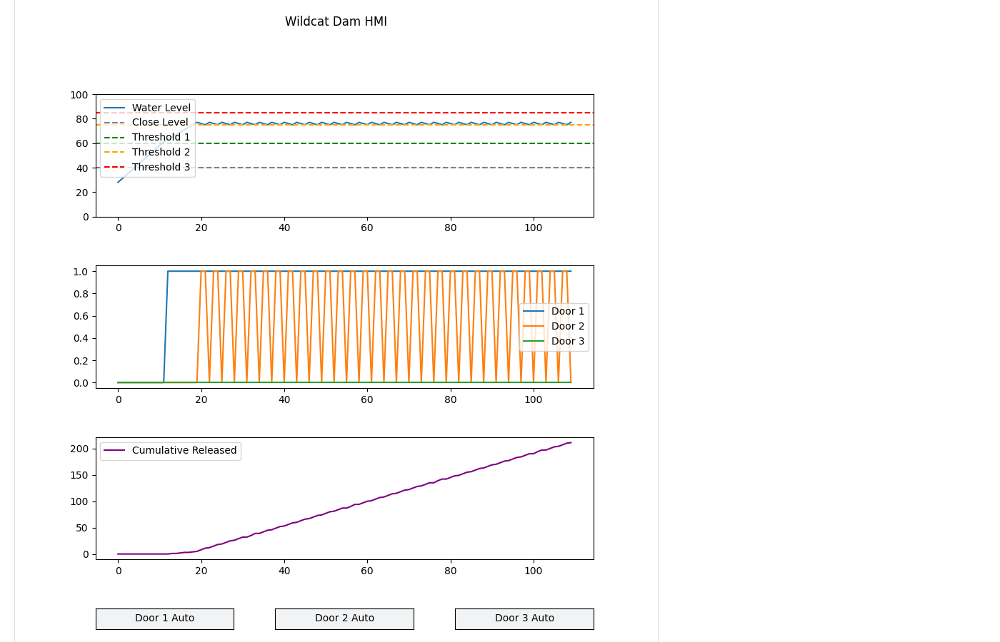

# Scenario 1: Reconnaissance

## Overview

| Field | Value |
|---|---|
| **Tactic** | Collection |
| **Techniques** | [T0861 - Point & Tag Identification](https://attack.mitre.org/techniques/T0861/) |
| **Adversary** | Wildcat Dam Modbus Reconnaissance (`docs/adversaries/modbus-reconnaissance.yml`) |
| **Fact source** | Wildcat Dam Facts (`docs/sources/wildcat-dam-simulator-facts.yml`) |

## Description

The adversary reads the dam controller's coils, discrete inputs, holding registers, and input registers without writing anything. The PLC answers any Modbus client, so this maps the door controls, door states, reduction rates, thresholds, and water level. The process is not changed.

## Facts Used

| Fact | Description | Type | Value |
|---|---|---|---|
| `modbus.server.ip` | IP address of the dam controller | string | `127.0.0.1` |
| `modbus.server.port` | Modbus TCP port | int | `5020` |
| `modbus.read_coil.start` | First coil to read | int | `0` |
| `modbus.read_coil.count` | Number of coils to read | int | `6` |
| `modbus.read_discrete.start` | First discrete input to read | int | `0` |
| `modbus.read_discrete.count` | Number of discrete inputs to read | int | `4` |
| `modbus.read_holding.start` | First holding register to read | int | `0` |
| `modbus.read_holding.count` | Number of holding registers to read | int | `7` |
| `modbus.read_input.start` | First input register to read | int | `0` |
| `modbus.read_input.count` | Number of input registers to read | int | `3` |

## Steps

Run the adversary with the fact source above, or add these abilities to an operation in this order:

| # | Ability | ID | Facts |
|---|---|---|---|
| 1 | Modbus - Scan Device | `7f43fa44-c2aa-4bb6-ba4b-2c1e58df3b51` | scan |
| 2 | Modbus - Read Coils | `d80b9cd5-b1d8-482a-a745-71d74f9d0885` | read: `modbus.read_coil.start=0`, `modbus.read_coil.count=6` |
| 3 | Modbus - Read Discrete Inputs | `001e21ea-61b5-4b78-b79e-9d5687d819bd` | read: `modbus.read_discrete.start=0`, `modbus.read_discrete.count=4` |
| 4 | Modbus - Read Holding Registers | `bc8961a2-7534-4b2a-bbc3-2456f58243be` | read: `modbus.read_holding.start=0`, `modbus.read_holding.count=7` |
| 5 | Modbus - Read Input Registers | `3946b6da-c570-47cd-b63f-c13875297cb4` | read: `modbus.read_input.start=0`, `modbus.read_input.count=3` |

## Expected Observations

- The PLC answers every read without authentication, and Scan Device lists all four data types.
- Coils 0-5 read `OFF,OFF,OFF,OFF,OFF,OFF`: the three manual door positions and the three override enables are off.
- Discrete inputs 0-3 hold the door states. About 20 seconds after start the level passes threshold 1 (60): inputs 0 (any door open) and 1 (door 1) read `ON`, input 2 (door 2) turns on and off as the level crosses threshold 2 (75), and input 3 (door 3) reads `OFF`.
- Holding registers 0-6 read `40,1,3,6,60,75,85`: the close level, the three reduction rates, and the three thresholds from `config.yaml`.
- Input registers 0-2 read the water level (settling between 75 and 77), the surge rate (`3`), and the running total of water released, which grows by 2 to 3 a second.
- No writes occur, so the process changes only through its own control loop.
