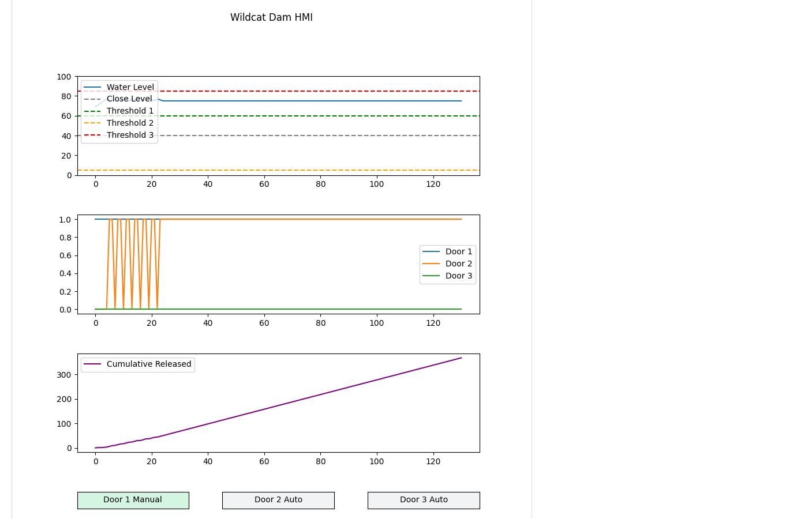

# Scenario 2: Manual Override

## Overview

| Field | Value |
|---|---|
| **Tactic** | Impair Process Control, Impact |
| **Techniques** | [T0855 - Unauthorized Command Message](https://attack.mitre.org/techniques/T0855/), [T0836 - Modify Parameter](https://attack.mitre.org/techniques/T0836/), [T0831 - Manipulation of Control](https://attack.mitre.org/techniques/T0831/) |
| **Adversary** | Wildcat Dam Modbus Manual Override (`docs/adversaries/modbus-manual-override.yml`) |
| **Fact source** | Wildcat Dam Facts (`docs/sources/wildcat-dam-simulator-facts.yml`) |

## Description

The adversary enables door 1's manual override and writes its position open, so door 1 no longer follows the automatic door logic. It then lowers door 2's threshold from 75 to 5 with a holding register write, so door 2 opens far below its normal level. The PLC accepts both writes from any Modbus client and acts on them on its next tick.

## Facts Used

| Fact | Description | Type | Value |
|---|---|---|---|
| `modbus.server.ip` | IP address of the dam controller | string | `127.0.0.1` |
| `modbus.server.port` | Modbus TCP port | int | `5020` |
| `modbus.read_coil.start` | First coil to read | int | `0` |
| `modbus.read_coil.count` | Number of coils to read | int | `6` |
| `modbus.read_holding.start` | First holding register to read | int | `0` |
| `modbus.read_holding.count` | Number of holding registers to read | int | `7` |
| `modbus.write_coil.start` | Coil to write | int | `3` (door 1 override enable), `0` (door 1 position) |
| `modbus.write_coil.value` | Value for a single coil write | string | `ON` |
| `modbus.write_register.start` | Holding register to write | int | `5` (threshold 2) |
| `modbus.write_register.value` | Value for a single register write | int | `5` |

## Control Data

| Control | Modbus Address | Value |
|---|---|---|
| `door_1.override_enable` | Coil `3` | `ON` |
| `door_1.position` | Coil `0` | `ON` |
| `thresholds.threshold_2` | Holding register `5` | `5` |

## Steps

Run the adversary with the fact source above, or add these abilities to an operation in this order:

| # | Ability | ID | Facts |
|---|---|---|---|
| 1 | Modbus - Read Coils | `d80b9cd5-b1d8-482a-a745-71d74f9d0885` | baseline: `modbus.read_coil.start=0`, `modbus.read_coil.count=6` |
| 2 | Modbus - Write Single Coil | `056e6289-4cbf-417f-928a-d75125e4db4f` | override: `modbus.write_coil.start=3`, `modbus.write_coil.value=ON` |
| 3 | Modbus - Write Single Coil | `056e6289-4cbf-417f-928a-d75125e4db4f` | open: `modbus.write_coil.start=0`, `modbus.write_coil.value=ON` |
| 4 | Modbus - Write Single Register | `d6991b6b-d3b2-4398-ad3f-d736ae09acf9` | threshold: `modbus.write_register.start=5`, `modbus.write_register.value=5` |
| 5 | Modbus - Read Holding Registers | `bc8961a2-7534-4b2a-bbc3-2456f58243be` | verify: `modbus.read_holding.start=0`, `modbus.read_holding.count=7` |

The adversary runs Write Single Coil once for each `modbus.write_coil.start` fact in the source, so it writes `ON` to coils 3 and 0 in either order.

## Expected Observations

- The baseline read returns coils `OFF,OFF,OFF,OFF,OFF,OFF`.
- Every write returns "Write successful", and the PLC logs each one, for example `Client wrote coil 3 = ON`.
- Holding registers read back `40,1,3,6,60,5,85`: register 5 (threshold 2) is now `5`, down from `75`.
- Coils 0 and 3 read `ON`. Discrete inputs 1 and 2 read `ON`: door 1 is held open by the override, and door 2 stays open because the level is above the new threshold.
- In the HMI, the Threshold 2 line drops to `5`, Doors 1 and 2 show open, and the Door 1 buttons read Manual and Open.
