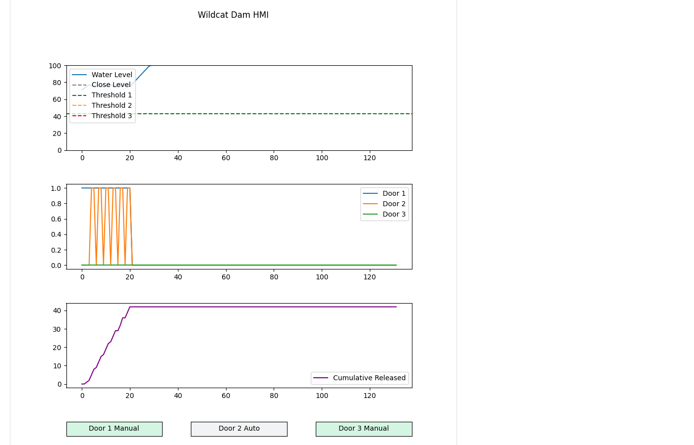

# Scenario 3: Chaos

## Overview

| Field | Value |
|---|---|
| **Tactic** | Collection, Impair Process Control |
| **Techniques** | [T0861 - Point & Tag Identification](https://attack.mitre.org/techniques/T0861/), [T0806 - Brute Force I/O](https://attack.mitre.org/techniques/T0806/) |
| **Adversary** | Wildcat Dam Modbus Chaos (`docs/adversaries/modbus-chaos.yml`) |
| **Fact source** | Wildcat Dam Facts (`docs/sources/wildcat-dam-simulator-facts.yml`) |

## Description

The adversary reads a baseline, then writes random values to the dam's coils and holding registers. The writes are untargeted: door positions, override enables, reduction rates, the close level, and thresholds change at random. The PLC accepts every write and runs its control loop on the corrupted values from the next tick on.

## Facts Used

| Fact | Description | Type | Value |
|---|---|---|---|
| `modbus.server.ip` | IP address of the dam controller | string | `127.0.0.1` |
| `modbus.server.port` | Modbus TCP port | int | `5020` |
| `modbus.read_coil.start` | First coil to read | int | `0` |
| `modbus.read_coil.count` | Number of coils to read | int | `6` |
| `modbus.read_holding.start` | First holding register to read | int | `0` |
| `modbus.read_holding.count` | Number of holding registers to read | int | `7` |
| `modbus.fuzz_coil.start` | First coil to fuzz | int | `0` |
| `modbus.fuzz_coil.end` | Last coil to fuzz | int | `5` |
| `modbus.fuzz_coil.count` | Number of random coil writes | int | `10` |
| `modbus.fuzz_coil.wait` | Delay between coil writes (seconds) | float | `0.1` |
| `modbus.fuzz_register.start` | First holding register to fuzz | int | `0` |
| `modbus.fuzz_register.end` | Last holding register to fuzz | int | `6` |
| `modbus.fuzz_register.count` | Number of random register writes | int | `10` |
| `modbus.fuzz_register.min` | Minimum random register value | int | `0` |
| `modbus.fuzz_register.max` | Maximum random register value | int | `999` |
| `modbus.fuzz_register.wait` | Delay between register writes (seconds) | float | `0.1` |

## Control Data

| Control | Modbus Address | Value |
|---|---|---|
| Door positions and override enables | Coils `0`-`5` | random `ON`/`OFF` |
| Close level, reduction rates, thresholds | Holding registers `0`-`6` | random `0`-`999` |

## Steps

Run the adversary with the fact source above, or add these abilities to an operation in this order:

| # | Ability | ID | Facts |
|---|---|---|---|
| 1 | Modbus - Read Coils | `d80b9cd5-b1d8-482a-a745-71d74f9d0885` | baseline: `modbus.read_coil.start=0`, `modbus.read_coil.count=6` |
| 2 | Modbus - Read Holding Registers | `bc8961a2-7534-4b2a-bbc3-2456f58243be` | baseline: `modbus.read_holding.start=0`, `modbus.read_holding.count=7` |
| 3 | Modbus - Fuzz Coils | `40f78a8f-2aaa-4b1b-872f-7c6b0f1ddf3e` | fuzz: `modbus.fuzz_coil.start=0`, `modbus.fuzz_coil.end=5`, `modbus.fuzz_coil.count=10`, `modbus.fuzz_coil.wait=0.1` |
| 4 | Modbus - Fuzz Registers | `2a6e8c8e-f350-11ed-9156-23436b8f0e58` | fuzz: `modbus.fuzz_register.start=0`, `modbus.fuzz_register.end=6`, `modbus.fuzz_register.count=10`, `modbus.fuzz_register.min=0`, `modbus.fuzz_register.max=999`, `modbus.fuzz_register.wait=0.1` |

## Expected Observations

- The baseline reads return the scenario 1 values (coils all `OFF`, holding registers `40,1,3,6,60,75,85`), or the values scenario 2 left if it ran first.
- Fuzz Coils and Fuzz Registers each report 10 successful writes, and the PLC logs each one, for example `Client wrote holding register 4 = 266`.
- Coils 0-5 hold random `ON`/`OFF` values, so some doors switch to manual control at a random position.
- Each holding register the fuzzer hit holds a random value from 0 to 999, usually far outside the 0-100 range of the close level and thresholds and the 0-10 range of the reduction rates. Each run hits different registers with different values.
- In the HMI, the Close Level and Threshold lines move or leave the 0-100 scale, and the doors open or close to match the new values.
